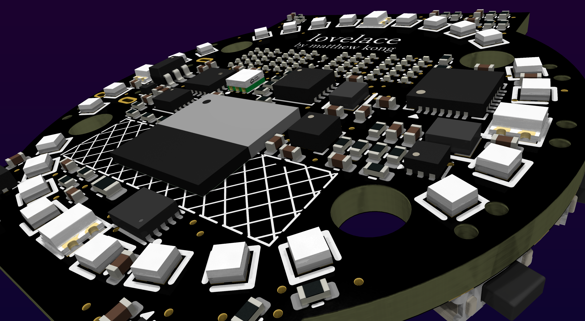

# lovelace watch

this is the repo for lovelace, a smart-ish watch in a thin, compact body. it has:

- four 3x5 led matrices to display the time
- 28 argb leds along the ring of the watch (for flashlight and notification purposes)
- bluetooth 6.0 connection to a smartphone 
- lra vibration motor for notifications
- step tracking
- raise to wake
- auto brightness
- compass
- usb-c charging

this repo currently houses the pcb for the watch. 